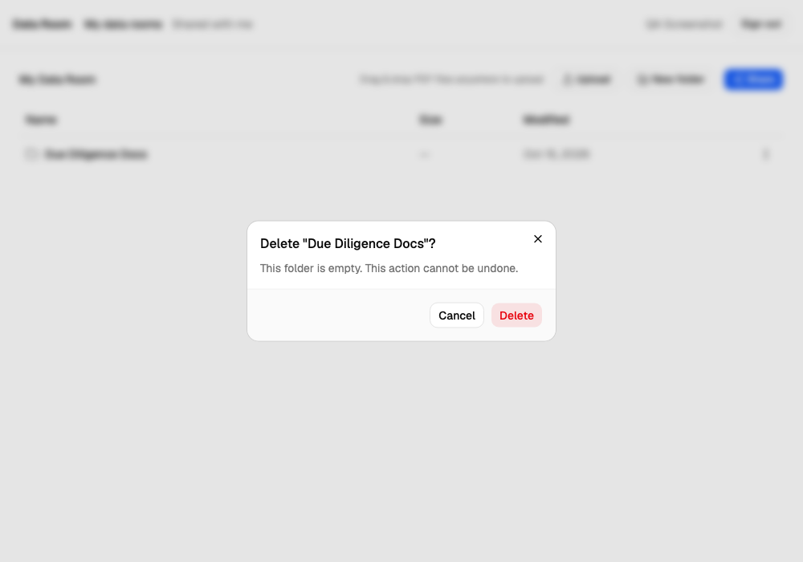
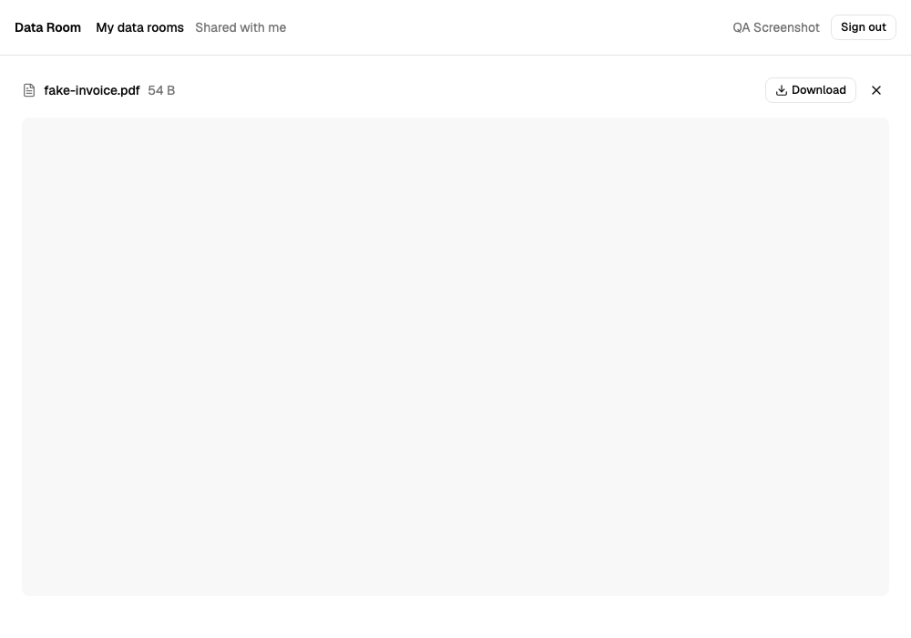
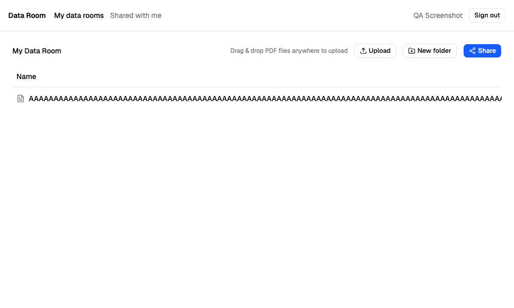

# Virtual Data Room — Findings Report

Oct 15, 2026 · @Zhanna · See [test-plan.md](test-plan.md) for my method and what each severity level means, and [manual-test-log.md](manual-test-log.md) for the full, step-by-step list of checks behind this report.

## Summary

I found no Critical or High severity bugs. Access control (R2) and sharing/revoking access (R13–R16) — the two riskiest areas for a due-diligence product — passed every manual check I did. Most of what I found is about upload error handling and how the app looks and feels.

| Severity | Count |
|---|---|
| Critical | 0 |
| High | 0 |
| Medium | 5 |
| Low | 18 |
| Open risk items (not confirmed bugs) | 3 |

## Medium

### M1 — [Delete folder] Confirmation dialog doesn't warn that the folder is shared
Area: Data integrity (R7) · Why it matters: A data room is used during real business deals. Cutting off a buyer's access with no warning is a real problem.
Expected: The dialog says something like "This folder is shared with 2 people and has a public link. They will lose access."
Actual: The warning shows how many items and how much size will be deleted, but says nothing about the shares.

### M2 — [Upload] Non-PDF file renamed to .pdf is accepted, then fails to open in the viewer
Area: Upload (R8) · Why it matters: In due diligence, a file that looks fine in the list but is actually broken is a real problem. Accepting any file content just because it's named .pdf is also a gap in checking the file.
Expected: The upload is rejected with a message like "This file isn't a valid PDF."
Actual: The upload works. Opening the file shows the browser's own error, "Failed to load PDF document," and the viewer's title bar shows an internal file ID (0b491ba5-...) instead of the real file name (1.pdf).

(Screenshot taken with an automated browser, which has no built-in PDF viewer at all, so it shows a blank area here rather than Chrome's own "Failed to load PDF document" error — the core bug is the same either way: the file is accepted and can't actually be viewed.)

### M3 — [Upload] Retry after connection loss fails with status 400; file can't be recovered
Area: Upload (R8) · Why it matters: If the connection is unstable, a user can't finish an upload by retrying — they have to start over, and nothing tells them why.
Steps: Upload 3 PDFs → go Offline mid-upload → "Some uploads failed – Network Error" → go back online → click Retry.
Expected: The file uploads successfully and appears once.
Actual: The retry fails with "Upload failed with status 400." The network log shows that the retry sends the file to the *same* storage link again, and storage rejects it (409 Duplicate – "The resource already exists" (KeyAlreadyExists)), instead of just confirming the upload that's already there. The screen shows this as a generic, confusing "status 400."
Related: L7 (failed uploads still "use up" their file name) comes from the same cause — uploads that failed are never cleaned up on the server.

### M4 — [File list] Long file name is not shortened — table expands and pushes columns off-screen
Area: Look and feel (R3, R10) · Why it matters: One long file name breaks the layout for the whole folder and hides the ⋮ menu on that row.
Expected: Long names get cut short with …, and the full name shows when you hover over it. The columns stay in place.
Actual: The full name is shown on one line, the table gets a horizontal scrollbar, and the Size/Modified columns and the actions menu get pushed off the screen.

### M5 — [Download] File names with parentheses or "&" are saved encoded — "Lorem ipsum (5).pdf" downloads as "Lorem ipsum %285%29.pdf"
Area: Download (R9) · Why it matters: The app's own conflict handling names duplicates "(1)", "(2)", so this hits every file the app has renamed, not just unusual names. In due diligence, the downloaded copies are what people keep and pass on, and they end up with broken names.
Steps: Download a file whose name contains parentheses, e.g. "Lorem ipsum (5).pdf".
Expected: The saved file is named "Lorem ipsum (5).pdf".
Actual: The saved file is named "Lorem ipsum %285%29.pdf". Names without special characters (Rental_agreement.pdf) download correctly; "&" breaks the same way ("a b&c.pdf" → "a b%26c.pdf"), spaces are fine.
Cause (checked by Claude against the live API): the download's Content-Disposition header encodes the name twice — filename*=UTF-8''Lorem%20ipsum%20%25285%2529.pdf, where %2528 is an already-encoded %28 encoded again. The browser decodes it once and saves %28.
I wrote a known-failing automated test for this in tests/specs/api/files-and-folders.spec.ts.

## Low

| # | Area | Finding | Note |
|---|---|---|---|
| L1 | Sharing | An owner can share an item with their own email address, and it then shows up in their own "Shared with me" | Expected to be blocked with a message |
| L2 | Navigation | The label "My data rooms" suggests you can have more than one, but each user only ever has exactly one, with no way to make another | The label doesn't match what the app actually lets you do |
| L3 | Upload | The file-type error message says what's wrong, but not what to do about it (e.g. "huge_flower.jpg is not a PDF") | Suggest: "huge_flower.jpg can't be uploaded. Only PDF files are supported." |
| L4 | Upload | When uploading a PDF and a non-PDF together, the error message covers part of the upload progress panel | Notifications should stack, not cover each other |
| L5 | Upload | The list of rejected files is hard to read (very light text), and shows as one long line separated by commas | This gets worse with 20+ rejected files — show one file per line instead, or "and N more" |
| L6 | Upload | Error messages use technical words ("Network Error", "status 400") instead of telling the user what to do | E.g. "Upload failed. Check your connection and try again." |
| L7 | Upload | A failed upload still "keeps" its file name. Uploading the same file again gets renamed with a higher number ((4) instead of (3)), even though nothing with that name is visible anywhere | Same cause as M3 — failed uploads are never cleaned up (the README also mentions this) |
| L8 | Navigation | The breadcrumb trail doesn't get shortened for deep folders or long names — it spreads over several lines and keeps growing | Low; would be Medium if it breaks the layout on a narrow screen |
| L9 | Folders | A folder name is limited to 50 characters, with no message — typing just silently stops | The user has no idea why typing stopped. Suggest a character counter, or a "Max 50 characters" message. Also inconsistent with renaming a file, which does show "Name is too long" (see manual-test-log R4 vs R10) |
| L10 | File viewer | The viewer's title bar shows the PDF's own internal title, or a storage ID, instead of the file's real name in the data room | Seen only with broken or untitled PDFs (see M2). When I checked again, normal PDFs showed the correct name |
| L11 | Rename | The rename box doesn't select the current name when it opens | The user has to delete the old name by hand first. For files, it would be better to select only the name part (not the .pdf ending) |
| L12 | Sharing | The share box's own on-screen check rejects an email with a space before or after it ("Enter a valid email") | Fixed during automation: Claude confirmed against the live API that this is only in the screen's own code — the API itself (CreateShareDto) already removes the extra spaces on its side, and the share works fine there. Fixing the share box's own check to remove spaces first would solve this, with no change needed on the server |
| L12b | Auth | Login and sign-up reject an email with a space before or after it, in the API itself, not only on screen | This has a different cause from L12, even though it looks the same: LoginDto/RegisterDto don't remove extra spaces before checking the email, so the server itself rejects it (400), no matter what the screen does. I wrote a known-failing automated test for this in tests/api/auth.spec.ts |
| L13 | Sharing | If a folder is shared directly, and also shared because its parent folder is shared, it shows up twice for the person it's shared with | This could be okay, but it's confusing without a hint like "Already shared through 'parent folder'" |
| L14 | Shared with me | The list doesn't show who shared an item, or which data room it came from | This matters once someone receives items shared by more than one person |
| L15 | File list | There's no total item count shown for large folders that use infinite scroll | Suggest e.g. "124 items" |
| L16 | File list | The row's actions menu (⋮) has no "View" or "Open" option — only Rename, Move, Download, Share, and Delete | Opening a file only works by clicking on the row itself, which you can't tell from the menu. Found while writing the browser test for the file viewer |
| L17 | Auth | Registering with an email that already has an account shows an error, but no way forward | Suggest a "Log in instead" link in the error that opens the login page with the email already filled in (a link rather than an automatic redirect, in case the email was mistyped). This doesn't reveal anything new, since the error already says the email is taken |

## Open risk items (not confirmed bugs — need a clear decision from the team)

I couldn't fully confirm whether these pass or fail during this round of testing. They look like deliberate design choices, so the team should make a clear decision about each one, instead of leaving it as an accident.

- No lockout or limit on repeated failed logins: after 11 wrong passwords in a row there was no warning, and the correct password still logged in straight away. A limit might still start at a higher number or work per IP address, so this is worth checking with the team before release, since this product is used for due diligence.
- Login tokens (JWTs) are not cancelled on the server when you log out (this is by design — the README says they last 7 days, with no way to refresh them). A token copied before logout (for example, from DevTools) may keep working until it expires naturally. This can be fine as a deliberate choice for a first version, but it shouldn't just happen by accident.
- A file-download link opened before access is revoked stays working for up to 5 minutes after the revoke (this matches the link's own lifetime, which the README documents). I checked this: the link worked right after revoking access, and stopped working about 5 minutes later. This is fine as a known, short time window, but it should be mentioned clearly in the release notes.
